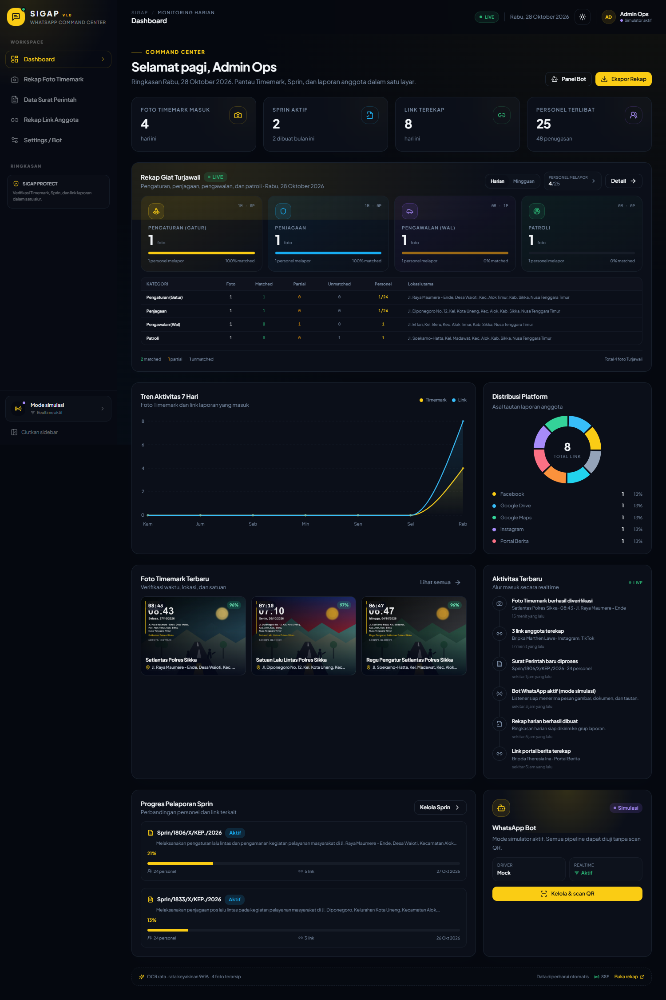
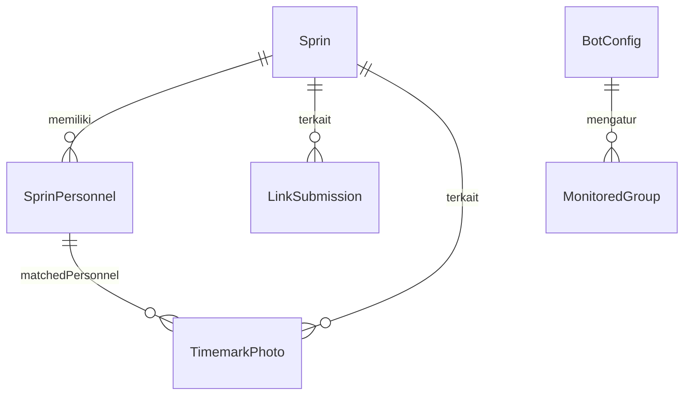
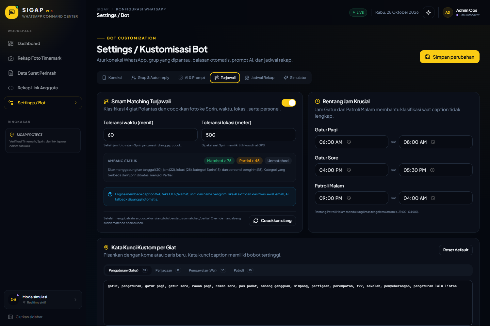

# SIGAP — WhatsApp Bot Listener & Command Center

Sistem full-stack untuk memantau laporan anggota dari WhatsApp: **OCR foto Timemark**, **parser Surat Perintah PDF/DOCX multi-halaman**, **rekap link anggota lintas platform**, **Smart Matching Turjawali (Pengaturan, Penjagaan, Pengawalan, Patroli)**, dan **dashboard React** dengan panel kustomisasi bot.

> **Status validasi (28 Okt 2026):** `pnpm typecheck` bersih, `pnpm test` **47/47 lulus**, smoke test API **49/49 asersi lulus**, dan dashboard telah diuji di Chrome (desktop + mobile, mode gelap/terang) tanpa console error. Basis data personel Satlantas (96 orang, 7 perwira) sudah diimpor dan terverifikasi, termasuk deteksi supervisi perwira dari caption. Proyek dipulihkan dari log sesi DSH dan dijalankan ulang dari nol (`pnpm install` → migrasi Prisma → seed) di `C:\Users\dings\Documents\deepseek-harness\default-workspace\sigap`.



---

## 1. Arsitektur & Tech Stack Termudah

### Arsitektur

```text
WhatsApp (grup/chat)
        │
        ▼
whatsapp-web.js listener ── QR / sesi / whitelist grup
        │  event message (non-blocking)
        ▼
PQueue (concurrency 2) ── auto-reply setelah selesai
        │
        ├── Gambar ─────► Sharp preprocess ─► Tesseract.js OCR ─► regex Timemark
        │                                      ├─ Smart Matching Turjawali
        │                                      └─ fallback Vision AI (opsional)
        ├── PDF/DOCX ───► pdf-parse v2 / mammoth ─► metadata + personel + kategori Sprin
        └── Teks URL ───► regex URL ─► klasifikasi platform ─► validasi HTTP ─► kaitkan Sprin
        │
        ▼
Prisma ORM ── SQLite (data/app.db)
        │
        ├── REST API (Express 5)
        ├── SSE /api/events  ── realtime ke dashboard
        └── Export CSV / XLSX / teks WhatsApp + Rekap Turjawali
        │
        ▼
React 19 + Vite + Tailwind CSS + komponen shadcn/ui + lucide-react
```

### Tech stack

| Lapisan | Teknologi | Alasan |
|---|---|---|
| Runtime | Node.js 22+, TypeScript 5.9 | Satu bahasa untuk backend & frontend, ekosistem WhatsApp/OCR matang |
| WhatsApp | `whatsapp-web.js` 1.34 + `puppeteer` | QR login, media download, event grup, tanpa WhatsApp Business API berbayar |
| OCR | `tesseract.js` + `sharp` | OCR lokal gratis, preprocess gambar, worker terpisah; tidak butuh cloud |
| Smart Matching | Rule engine + scoring + AI fallback | Menggabungkan waktu, lokasi, caption, Sprin, dan personel |
| Vision AI | OpenAI-compatible HTTP | Fallback opsional untuk foto sulit; prompt dapat diedit dari dashboard |
| Surat Perintah | `pdf-parse` v2 + `mammoth` + `cheerio` | Deteksi tabel PDF, ekstraksi tabel DOCX, regex metadata Polri |
| Link | Regex + `fetch` HEAD | Deteksi URL, klasifikasi platform, validasi HTTP tanpa browser |
| Database | SQLite + Prisma 6.19 | Nol konfigurasi server DB, migrasi ikut repo, mudah dibackup |
| Backend | Express 5 + Zod + Pino | Ringan, async-native, validasi input, log terstruktur |
| Realtime | Server-Sent Events (SSE) | Lebih sederhana dari WebSocket, cukup untuk dashboard monitoring |
| Frontend | React 19, Vite 7, Tailwind 3.4, shadcn/ui | Cepat, modular, komponen aksesibel, mudah dikustomisasi |
| Export | ExcelJS + CSV builder | Rekap `.xlsx` multi-sheet, CSV, dan teks siap WhatsApp |
| Deployment | Docker + Chromium + Tesseract data lokal | Satu container, volume persisten, QR langsung dari dashboard |

### Mengapa struktur satu paket?

Proyek ini sengaja memakai **satu paket full-stack** (bukan monorepo multi-package) agar:

- `pnpm install` dan `pnpm dev` hanya satu langkah.
- Path komponen yang diminta benar-benar berada di **`/components/ui/dashboard-with-collapsible-sidebar.tsx`**.
- Tipe data bersama (`shared/types.ts`) dipakai backend dan frontend tanpa build package tambahan.
- Docker hanya perlu satu build context.

---

## 2. Struktur Proyek

```text
.
├── components/
│   ├── ui/
│   │   ├── dashboard-with-collapsible-sidebar.tsx  ← shell dashboard (WAJIB)
│   │   ├── button.tsx / card.tsx / dialog.tsx / table.tsx / ...
│   │   └── ...
│   └── sigap/
│       ├── page-header.tsx
│       ├── platform-badge.tsx
│       ├── stat-card.tsx
│       └── status-badge.tsx
├── server/
│   ├── index.ts                     ← bootstrap API + graceful shutdown
│   ├── app.ts                       ← Express, static frontend, error handler
│   ├── config.ts                    ← env, path storage, TZ
│   ├── routes/
│   │   ├── stats.ts / timemark.ts / sprin.ts / links.ts
│   │   ├── settings.ts / whatsapp.ts / reports.ts / exports.ts
│   │   └── events.ts                ← SSE
│   ├── services/
│   │   ├── whatsapp-manager.ts      ← QR, listener, queue, auto-reply
│   │   ├── ocr/
│   │   │   ├── timemark-ocr.ts      ← Sharp + Tesseract + AI fallback
│   │   │   ├── timemark-parser.ts   ← regex jam/tanggal/alamat/koordinat
│   │   │   ├── turjawali-matcher.ts ← klasifikasi + smart scoring + AI fallback
│   │   │   └── text-utils.ts
│   │   ├── documents/
│   │   │   ├── sprin-reader.ts      ← PDF/DOCX reader
│   │   │   ├── sprin-parser.ts      ← metadata + tabel personel
│   │   │   └── types.ts
│   │   ├── links/
│   │   │   ├── extractor.ts         ← URL, platform, dedupe
│   │   │   └── validator.ts         ← validasi HTTP
│   │   ├── timemark-service.ts / sprin-service.ts / link-service.ts
│   │   ├── turjawali-recap-service.ts ← matriks harian/mingguan + status personel
│   │   ├── stats-service.ts / export-service.ts / scheduler-service.ts
│   │   └── simulation-service.ts    ← simulasi pesan masuk
│   └── lib/                         ← Prisma, SSE bus, serializer, dates
├── src/
│   ├── pages/
│   │   ├── dashboard.tsx
│   │   ├── timemark.tsx
│   │   ├── sprin.tsx
│   │   ├── links.tsx
│   │   └── settings.tsx
│   ├── lib/                         ← realtime context, theme
│   ├── hooks/use-api.ts
│   ├── App.tsx / main.tsx / index.css
├── shared/types.ts                  ← kontrak DTO backend ↔ frontend
├── prisma/
│   ├── schema.prisma
│   ├── migrations/
│   └── seed.ts                      ← data demo + parser asli
├── scripts/
│   ├── fixture-generator.ts         ← foto Timemark sintetis + PDF/DOCX demo
│   ├── api-smoke.mjs                ← 48 asersi end-to-end
│   ├── e2e-turjawali.mjs            ← uji UI filter/override/settings
│   ├── test-wa-connect.mjs          ← uji QR WhatsApp Web
│   └── docker-entrypoint.sh
├── tests/                           ← Vitest (47 tes: Turjawali, impor Sprin, roster personel, supervisi)
├── tessdata/eng.traineddata         ← model OCR lokal (5.2 MB)
├── Dockerfile / docker-compose.yml
├── .env.example
└── README.md
```

---

## 3. Panduan Setup Proyek & Instalasi

### Prasyarat

- **Node.js ≥ 22.12** (disarankan 22 LTS atau 24).
- **pnpm 11** (`npm install -g pnpm@11.28.5`).
- **Chrome/Chromium** hanya untuk mode WhatsApp Web nyata. Mode simulasi tidak membutuhkannya.
- Windows/macOS/Linux. Docker opsional.

> Model Tesseract `eng.traineddata` **sudah disertakan** di `tessdata/`, jadi OCR pertama tidak perlu mengunduh model.

### Setup lokal (Windows PowerShell / bash)

```bash
# 1. Salin environment
cp .env.example .env          # Linux/macOS
# Copy-Item .env.example .env # Windows PowerShell

# 2. Install dependency
pnpm install
# Jika pnpm menanyakan build scripts:
pnpm approve-builds --all

# 3. Generate Prisma Client, migrasi SQLite, dan seed data demo
pnpm setup

# 4. Jalankan backend + frontend bersamaan
pnpm dev
```

Akses:

| Layanan | URL |
|---|---|
| Dashboard (Vite) | http://localhost:5173 |
| API | http://localhost:3000 |
| Health check | http://localhost:3000/api/health |
| Prisma Studio | `pnpm db:studio` |

Frontend Vite mem-proxy `/api` dan `/media` ke port 3000, sehingga tidak ada konfigurasi CORS tambahan saat development.

### Setup cepat alternatif (satu perintah)

```bash
pnpm install && pnpm setup && pnpm dev
```

### Mode operasi

1. **Mode simulasi (default, aman)** — tanpa WhatsApp. Semua pipeline diuji dari tab **Settings → Simulator** atau `POST /api/wa/simulate`.
2. **WhatsApp Web** — buka **Settings → Koneksi**, pilih *WhatsApp Web*, simpan, lalu klik **Hubungkan & tampilkan QR**. Pindai dari WhatsApp → *Perangkat tertaut*.

Sesi WhatsApp disimpan di `data/wa-session/` (lokal) atau `/data/wa-session` (Docker).

### Environment variables

| Variabel | Default | Keterangan |
|---|---|---|
| `DATABASE_URL` | `file:../data/app.db` | Path SQLite relatif terhadap `prisma/`; Docker memakai `file:/data/app.db` |
| `PORT` | `3000` | Port API dan static frontend produksi |
| `NODE_ENV` | `development` | `production` menyajikan `dist/` |
| `APP_BASE_URL` | `http://localhost:5173` | URL dashboard saat dev |
| `STORAGE_DIR` | `./storage` | Gambar, thumbnail, PDF/DOCX |
| `WA_DRIVER` | `mock` | Nilai awal driver; dapat diubah dari dashboard |
| `WA_SESSION_PATH` | `./data/wa-session` | Sesi LocalAuth WhatsApp |
| `WA_WEB_VERSION` | kosong | Pin versi WhatsApp Web (mis. `2.3000.1047399436-alpha`) bila `downloadMedia`/`getChats` gagal setelah WA Web terbaru |
| `PUPPETEER_EXECUTABLE_PATH` | kosong | Path Chrome/Chromium; Docker `/usr/bin/chromium` |
| `TZ` | `Asia/Jakarta` | Zona waktu server, laporan, dan cron |
| `CORS_ORIGIN` | `http://localhost:5173` | Origin frontend yang diizinkan |
| `MAX_UPLOAD_MB` | `25` | Batas upload media |
| `LOG_LEVEL` | `info` | Level Pino |
| `SEED_DEMO` | `true` (Docker) | Seed data demo saat container pertama kali |

---

## 4. Skema Database

File: [`prisma/schema.prisma`](prisma/schema.prisma). Migrasi: [`init`](prisma/migrations/20261027142451_init/migration.sql) dan [`turjawali_smart_matching`](prisma/migrations/20261027153551_turjawali_smart_matching/migration.sql).

### Tabel utama

| Model | Isi | Relasi |
|---|---|---|
| `BotConfig` | driver WA, auto-reply, prompt/jadwal, ambang OCR, aturan Turjawali (jam, toleransi, keywords JSON) | singleton `id=singleton` |
| `MonitoredGroup` | whitelist grup (`jid`, nama, aktif) | — |
| `WhatsAppSession` | status koneksi, nomor, pushname, error, QR timestamp | singleton `id=runtime` |
| `TimemarkPhoto` | OCR lengkap, caption, `turjawaliType`, `matchStatus`, `matchScore`, `matchedPersonnelId`, `matchNotes` | `sprinId?`, `matchedPersonnelId?` |
| `Sprin` | nomor unik, metadata, tempat, koordinat, `turjawaliType`, file | 1-N personel, link, timemark |
| `SprinPersonnel` | NO, NAMA, PANGKAT/NRP, JABATAN, PENUGASAN, KET, halaman | `sprinId` cascade; 1-N timemark matched |
| `LinkSubmission` | URL asli & normalisasi, platform, kategori, pengirim, status HTTP | `sprinId?` |
| `Activity` | feed realtime dashboard | — |

### Relasi ringkas



### Seed demo

`pnpm db:seed` akan:

- Membuat **4 foto Timemark** sintetis dengan watermark, caption berbeda, dan hasil Smart Matching: 2 MATCHED, 1 PARTIAL, 1 UNMATCHED.
- Mengisi tepat **1 foto per kategori Turjawali** untuk demo dashboard.
- Menjalankan **parser asli** pada teks OCR contoh (`parseTimemarkText`) lalu **matcher asli** (`matchTurjawali`).
- Menggenerate **PDF 3 halaman** dan **DOCX 2 halaman** berisi 24 personel, lalu memprosesnya melalui `ingestSprin` (PDF → PENGATURAN, DOCX → PENJAGAAN).
- Mengisi 8 link dari 8 platform, 3 grup whitelist, pengaturan bot, dan feed aktivitas.
- Idempotent untuk data ber-ID tetap; aman dijalankan ulang.

---

## 5. Kode Backend (Listener & Parser Engine)

### 5.1 WhatsApp listener

File utama: [`server/services/whatsapp-manager.ts`](server/services/whatsapp-manager.ts)

- `LocalAuth` menyimpan sesi di volume persisten.
- Event `qr` → QR diubah menjadi data URL via `qrcode`, disiarkan lewat SSE.
- `message` → validasi whitelist grup → identifikasi pengirim → unduh media → masukkan ke **PQueue concurrency 2** (event loop tidak diblokir).
- Tipe yang ditangani:
  - `image` → pipeline OCR Timemark.
  - `document` PDF/DOCX → pipeline parser Sprin.
  - teks ber-URL → pipeline link aggregator.
- Auto-reply mengisi placeholder `{name}` dan `{summary}` setelah pemrosesan selesai.
- `messageId` dipakai untuk deduplikasi agar pesan yang sama tidak diproses dua kali.
- Driver `mock` memakai status `mock`, tidak menjalankan Chrome.

Endpoint koneksi: `GET /api/wa/status`, `POST /api/wa/connect`, `POST /api/wa/restart`, `POST /api/wa/logout`, `GET /api/wa/groups`, `POST /api/wa/simulate`.

### 5.2 OCR Foto Timemark

File: [`timemark-ocr.ts`](server/services/ocr/timemark-ocr.ts) dan [`timemark-parser.ts`](server/services/ocr/timemark-parser.ts)

Pipeline:

1. `sharp` rotate, resize ≤1800 px, grayscale, normalize, sharpen.
2. Tesseract.js mode `SPARSE_TEXT`, `preserve_interword_spaces`, worker antrean tunggal.
3. Jika hasil kurang/confidence rendah, jalankan pass kedua dengan threshold.
4. Parser regex:
   - **Jam** — `08:43`, `Pukul 07:10`, `06.47`
   - **Tanggal** — `Minggu, 04/10/2026`, `05/02/2026 Kamis`
   - **Alamat** — `Jl./Jalan`, `Desa/Kel./Kelurahan`, `Kec.`, `Kab./Kota`, 38 provinsi
   - **Satuan** — `Satlantas`, `Satreskrim`, `Polres`, `Polsek`, `Satuan`, `Regu`, dll.
   - **Koordinat** — desimal `8.619101°S, 122.217334°E`, DMS `8°37'08.8"S`, atau signed `-8.619101, 122.217334`
5. Normalisasi OCR umum: `JI.` → `Jl.`, smart quotes, en dash, spasi ganda.
6. Confidence gabungan = 62% confidence engine + 38% kelengkapan field.
7. Jika AI diaktifkan dan hasil OCR kurang, panggil endpoint OpenAI-compatible dengan prompt yang dapat diedit dari dashboard.

Contoh output JSON:

```json
{
  "timeText": "08:43",
  "dateText": "Selasa, 27/10/2026",
  "capturedAt": "2026-10-27T01:43:00.000Z",
  "address": "Jl. Raya Maumere - Ende, Desa Waioti, Kec. Alok Timur, Kab. Sikka, Nusa Tenggara Timur",
  "village": "Waioti",
  "district": "Alok Timur",
  "regency": "Sikka",
  "province": "Nusa Tenggara Timur",
  "unitName": "Satlantas Polres Sikka",
  "coordinateText": "8.619101°S, 122.217334°E",
  "latitude": -8.619101,
  "longitude": 122.217334,
  "confidence": 96
}
```

### 5.3 Pembaca Sprin PDF/DOCX

File: [`sprin-reader.ts`](server/services/documents/sprin-reader.ts) dan [`sprin-parser.ts`](server/services/documents/sprin-parser.ts)

- **PDF**:
  - `pdf-parse` v2 `getText()` untuk teks per halaman.
  - `getTable()` untuk mendeteksi grid tabel vektor.
  - Fallback heuristik teks: mengelompokkan baris bernomor menjadi blok, mendeteksi `NO NAMA PANGKAT/NRP JABATAN PENUGASAN KET`.
  - Pemilihan kandidat terbaik per nomor personel (skor kualitas baris) sehingga baris yang terpecah tidak menimpa baris yang lengkap.
- **DOCX**:
  - `mammoth.convertToHtml` + `cheerio` membaca `<table>` asli, termasuk header berulang di tabel lanjutan.
  - Fallback `extractRawText` jika tabel tidak terdeteksi.
- Metadata: Nomor Sprin, Dasar, Perihal/“Untuk”, tanggal (prioritas baris `TANGGAL:` bukan tanggal di Dasar), waktu, tempat, penandatangan + pangkat.
- Personel: NO, NAMA, PANGKAT/NRP (dipecah rank & NRP), JABATAN, PENUGASAN, KET, halaman, raw row.
- Nomor Sprin duplikat → update data & ganti personel (bukan duplikasi).
- Bila AI aktif dan hasil rule-based kurang, prompt dokumen dikirim sebagai fallback.

Contoh output ringkas:

```json
{
  "number": "Sprin/1806/X/KEP./2026",
  "about": "Melaksanakan pengaturan lalu lintas dan pengamanan kegiatan pelayanan masyarakat di Jl. Raya Maumere - Ende",
  "activityDate": "2026-10-27T00:00:00.000Z",
  "timeText": "08:00",
  "place": "Jl. Raya Maumere - Ende, Desa Waioti, Kec. Alok Timur, Kab. Sikka",
  "signatory": "ANDI PRATAMA, S.I.K., M.H",
  "signatoryRank": "AKBP",
  "personnel": [
    {
      "no": 1,
      "name": "IPDA ANDI SAPUTRA",
      "rankNrp": "IPDA/850101",
      "jabatan": "KANIT TURJAG",
      "penugasan": "KOORDINATOR",
      "ket": "PDU I",
      "page": 2
    }
  ]
}
```

### 5.3b Impor personel dari Excel/CSV

Dipakai bila daftar personel hanya tersedia sebagai spreadsheet (tanpa dokumen Sprin PDF/DOCX).
Alurnya dua langkah, keduanya dari halaman **Data Surat Perintah**:

1. **Buat Sprin** (tombol `Buat Sprin`) — isi nomor, perihal, tanggal, tempat, penandatangan, dan
   uraian tugas. Kategori Turjawali dideteksi otomatis atau bisa dipilih manual.
   Endpoint: `POST /api/sprin/manual`.
2. **Impor Excel/CSV** — buka detail Sprin → tab **Personel** → `Impor Excel/CSV`.
   Endpoint: `POST /api/sprin/:id/personnel/import` (field `file` + `mode=replace|append`).

Parser sheet: [`personnel-sheet.ts`](server/services/documents/personnel-sheet.ts)

- Menerima `.xlsx`, `.xlsm`, dan `.csv` (pemisah `,` `;` atau tab; kutip ganda & baris multiline didukung).
- Header kolom dideteksi otomatis: `NO`, `NAMA`, `PANGKAT/NRP` (atau `PANGKAT` + `NRP` terpisah),
  `JABATAN`, `PENUGASAN`, `KET`. Baris header berulang dan baris kosong dilewati.
- Bila header tidak dikenali, kolom dibaca berurutan (NO, NAMA, PANGKAT/NRP, JABATAN, PENUGASAN, KET)
  dan sebuah peringatan dikembalikan.
- Mode **ganti** menghapus personel lama pada Sprin tersebut; mode **tambah** melewati duplikat
  (nama + NRP) dan meneruskan nomor urut.
- Template siap pakai: [`public/template-personel.csv`](public/template-personel.csv)
  (juga bisa diunduh dari dialog impor).

```bash
curl -X POST http://localhost:3000/api/sprin/<id>/personnel/import \
  -F "file=@personel-sprin.xlsx" -F "mode=replace"
# → { "personnelCount": 24, "imported": 24, "skipped": 0, "warnings": [], "mode": "replace" }
```

### 5.3c Basis data personel & deteksi supervisi perwira

Selain personel per-Sprin, ada **basis data personel** (roster) yang berdiri sendiri — berisi seluruh
anggota satuan beserta nomor HP — dan dipakai untuk mengenali pengirim WhatsApp serta mendeteksi
perwira yang menyupervisi kegiatan.

**Unggah/ganti dari Settings → tab Personel**

- Berkas `XLSX`/`XLSM`/`CSV` dengan kolom `NO`, `NAMA`, `PANGKAT`, `NRP`, `JABATAN`, `NO HP`
  (kolom `SANDI` dan `SATUAN` opsional, kolom penyangga kosong diabaikan).
- Nomor HP dinormalkan ke format `62xxxxxxxxxx`, sehingga `0812…`, `+62 812…`, dan `62812…` dianggap sama.
- Mode **ganti seluruh data** dipakai saat ada mutasi personel (upload ulang file terbaru);
  mode **tambah/perbarui** mencocokkan baris berdasarkan NRP lalu nama.
- Ringkasan: jumlah personel, perwira, dan yang belum punya nomor HP.
- Endpoint: `GET /api/personnel`, `POST /api/personnel/import`, `GET|PUT /api/personnel/sandi`.

**Peta sandi (call sign)**

| Sandi | Pemegang |
|---|---|
| `12.1` – `12.6` | Kasat Lantas, KBO, Kaur Mintu, Kanit Regident, Kanit Turjagwali, Kanit Gakkum (otomatis dari jabatan) |
| `AGUNG 1` | Kapolres |
| `AGUNG 2` | Wakapolres |
| `AGUNG 4` | Kabag Ops |
| `AGUNG 12` | Kasat Lantas |
| `AGUNG` lainnya | **Tidak diterjemahkan otomatis** — bot menyimpan kode apa adanya sesuai caption anggota; operator dapat memetakan manual bila sudah pasti |

Pemetaan otomatis dari jabatan hanya untuk sandi yang sudah dipastikan. Peta disimpan pada
`BotConfig.officerSandiMap`.

**Deteksi supervisi** ([`supervision-detector.ts`](server/services/ocr/supervision-detector.ts))
dijalankan setiap foto Timemark masuk, memakai caption WhatsApp + teks OCR:

1. **Sandi** — `12.1`…`12.6` (juga `12,1`) dan `Agung 1`…`Agung 16` (juga `AGUNG-6`); kode yang
   belum dipetakan tetap dicatat apa adanya.
2. **Pengirim perwira** — nomor HP pengirim dicocokkan ke roster, lalu pangkat dicek
   (`IPDA`, `IPTU`, `AKP`, `KOMPOL`, `AKBP`).
3. **Pangkat + kata kunci** — mis. “supervisi oleh AKP …”, “pengecekan lokasi”, “sidak”.
4. Nama perwira disebut di caption (minimal dua kata sama) → dihubungkan ke roster.

Hasilnya disimpan di `TimemarkPhoto` (`isSupervision`, `supervisorSandi`, `supervisorName`,
`supervisorRank`, `supervisorPersonnelId`), tampil sebagai badge **Supervisi** di daftar foto,
kartu **Supervisi Perwira** di dashboard, bagian `SUPERVISI PERWIRA` pada teks rekap WhatsApp,
serta sheet **Supervisi Perwira** dan kolom `Supervisi`/`Sandi` pada ekspor XLSX.

### 5.4 Rekap Link Anggota

File: [`extractor.ts`](server/services/links/extractor.ts) + [`validator.ts`](server/services/links/validator.ts)

- Ekstraksi URL dari teks, strip tanda baca akhir, normalisasi trailing slash & parameter tracking (`utm_*`, `igsh`, `fbclid`, `si`).
- Platform: Instagram, TikTok, Facebook, YouTube, X/Twitter, Google Drive/Docs, Google Maps, WhatsApp, portal berita, website.
- Validasi HTTP HEAD (fallback GET) dengan timeout 7 detik:
  - `valid` (2xx/3xx), `restricted` (401/403/429), `invalid` (4xx/5xx), `unchecked` (network error).
- Link dikaitkan ke Sprin bila pesan menyebut nomor Sprin, atau berdasarkan tanggal kegiatan ±3 hari.
- Validasi berjalan di background, tidak memperlambat pesan masuk.

### 5.5 Smart Matching Turjawali

Engine: [`turjawali-matcher.ts`](server/services/ocr/turjawali-matcher.ts)  
Rekap: [`turjawali-recap-service.ts`](server/services/turjawali-recap-service.ts)

Klasifikasi 4 giat:

| Kategori | Sinyal utama |
|---|---|
| `PENGATURAN` | gatur, pengaturan, simpang/pertigaan, rawan pagi/sore, TKK/sekolah, ambang gangguan; jam Gatur Pagi/Sore |
| `PENJAGAAN` | penjagaan, jaga pos, pos lantas/pam/yan, strong point, mako, objek vital |
| `PENGAWALAN` | pengawalan, patwal, VVIP/VIP, konvoi, rombongan, estafet |
| `PATROLI` | patroli, hunting, blue light patrol/BLP, rawan laka/macet, balap liar; jam Patroli Malam |

Sinyal diambil dari **caption WhatsApp (bobot tertinggi)**, teks OCR/alamat/unit, dan teks Sprin. Rentang jam serta kata kunci dapat diubah dari **Settings → Turjawali**.

Scoring (maks. 100):

| Komponen | Bobot maks. |
|---|---:|
| Tanggal foto vs tanggal Sprin | 30 |
| Jam foto vs jam Sprin (toleransi menit) | 22 |
| Lokasi teks / GPS (radius meter) | 25 |
| Kategori foto vs kategori Sprin | 18 |
| Nama pengirim vs personel Sprin | 18 |

Status: **MATCHED ≥ 75**, **PARTIAL_MATCH ≥ 45**, **UNMATCHED < 45**. Jika kategori foto berbeda dari kategori Sprin, skor dibatasi maksimal 70 (partial) agar operator memverifikasi.

AI fallback dipanggil hanya bila AI aktif dan klasifikasi awal lemah/ambigu. Hasil yang disimpan pada `TimemarkPhoto`:

```json
{
  "turjawaliType": "PENGATURAN",
  "matchStatus": "MATCHED",
  "matchScore": 100,
  "matchedPersonnelId": "…",
  "matchNotes": "Tanggal sama…; GPS dalam radius 0 m…; pengirim cocok…",
  "senderCaption": "Izin komandan, giat gatur pagi simpang TKK…"
}
```

Endpoint rekap:

- `GET /api/timemark/turjawali-recap?period=daily|weekly&date=YYYY-MM-DD`
- `PATCH /api/timemark/:id/turjawali` body `{ "turjawaliType": "PATROLI" }` untuk override manual + rematch.
- `POST /api/timemark/rematch` body `{ "scope": "both" | "unmatched" | "partial" }` untuk mencocokkan ulang foto yang belum/parsial cocok. Override manual yang sudah MATCHED tidak disentuh.

Dashboard juga menyediakan:

- Toggle **Harian/Mingguan** pada kartu Rekap Giat Turjawali.
- Dialog **Cakupan Laporan Personel** berisi daftar sudah/belum melapor, filter, pencarian, dan tombol salin daftar personel belum melapor ke WhatsApp.

### 5.6 Export & scheduler

- `GET /api/exports/daily.xlsx` — 7 sheet: Ringkasan, **Rekap Turjawali**, **Personel Turjawali**, Foto Timemark, Surat Perintah, Personel, Link Anggota.
- `GET /api/exports/daily.txt` — teks siap tempel WhatsApp dengan bagian **REKAP TURJAWALI POLANTAS**.
- `GET /api/exports/links.csv`, `timemark.csv`, `sprin.csv`, **`turjawali.csv`**.
- `node-cron` + timezone, dijadwalkan ulang saat settings disimpan.
- `POST /api/reports/send` untuk kirim manual.

Contoh bagian Turjawali pada `daily.txt`:

```text
*SIGAP COMMAND CENTER*
*REKAP HARIAN — SELASA, 27 OKTOBER 2026*

📸 Foto Timemark : *4*
📄 Sprin          : *2*
🔗 Link Anggota   : *8*
👮 Personel        : *48*

┌──────────────────────
│ *REKAP TURJAWALI POLANTAS*
└──────────────────────
1. *PENGATURAN (GATUR)* — 1 foto (1 matched / 0 partial / 0 unmatched)
   👮 Melapor: 1/24 personel
   📍 Jl. Raya Maumere - Ende, Desa Waioti, Kec. Alok Timur, Kab. Sikka
2. *PENJAGAAN* — 1 foto (1 matched / 0 partial / 0 unmatched)
   👮 Melapor: 1/24 personel
   📍 Jl. Diponegoro No. 12, Kel. Kota Uneng, Kec. Alok, Kab. Sikka
3. *PENGAWALAN (WAL)* — 1 foto (0 matched / 1 partial / 0 unmatched)
   👮 Melapor: 1 personel
   📍 Jl. El Tari, Kel. Beru, Kec. Alok Timur, Kab. Sikka
4. *PATROLI* — 1 foto (0 matched / 0 partial / 1 unmatched)
   👮 Melapor: 1 personel
   📍 Jl. Soekarno-Hatta, Kel. Madawat, Kec. Alok, Kab. Sikka
✅ Total: 2 matched · 1 partial · 1 unmatched
👥 Personel aktif: 4/25 sudah melapor
──────────────────────
```

### 5.7 Ringkasan endpoint API

| Method | Endpoint | Fungsi |
|---|---|---|
| GET | `/api/health` | Health + cek DB |
| GET | `/api/stats` | Statistik dashboard |
| GET | `/api/activities` | Feed aktivitas |
| GET | `/api/timemark` | List/filter/paginate foto + filter `turjawaliType`/`matchStatus` |
| POST | `/api/timemark/analyze` | Upload gambar + OCR + Smart Matching |
| GET | `/api/timemark/turjawali-recap` | Matriks harian/mingguan + status personel |
| PATCH | `/api/timemark/:id/turjawali` | Koreksi kategori manual + rematch |
| POST | `/api/timemark/rematch` | Rematch massal unmatched/partial |
| DELETE | `/api/timemark/:id` | Hapus foto + file |
| GET | `/api/sprin` | List/filter Sprin |
| POST | `/api/sprin/upload` | Upload PDF/DOCX + parse |
| POST | `/api/sprin/manual` | Buat/perbarui header Sprin tanpa dokumen |
| POST | `/api/sprin/:id/personnel/import` | Impor personel dari XLSX/CSV (`mode=replace\|append`) |
| GET | `/api/sprin/:id` | Detail + seluruh personel |
| PATCH | `/api/sprin/:id/status` | Aktif/selesai/arsip |
| DELETE | `/api/sprin/:id` | Hapus Sprin + personel + dokumen tersimpan |
| GET | `/api/links` | List/filter link |
| GET | `/api/links/summary` | Agregat status/platform |
| POST | `/api/links/:id/validate` | Validasi ulang |
| GET/PUT | `/api/settings` | Baca/simpan konfigurasi bot |
| GET | `/api/personnel` | Roster personel + statistik (cari/filter) |
| POST | `/api/personnel/import` | Unggah/ganti basis data personel (XLSX/CSV) |
| GET/PUT | `/api/personnel/sandi` | Baca/simpan peta sandi 12.x dan Agung 1–16 |
| POST/PATCH/DELETE | `/api/settings/groups...` | CRUD whitelist |
| GET | `/api/wa/status` | Status WhatsApp |
| POST | `/api/wa/connect` | Mulai/QR |
| POST | `/api/wa/restart` / `disconnect` / `logout` | Kontrol sesi |
| GET | `/api/wa/groups` | Daftar grup dari sesi |
| POST | `/api/wa/simulate` | Simulasi foto/dokumen/link |
| GET | `/api/reports/preview` | Teks rekap |
| POST | `/api/reports/send` | Kirim rekap sekarang |
| GET | `/api/events` | SSE realtime |

---

## 6. Kode Frontend

Komponen utama yang diminta:

**[`components/ui/dashboard-with-collapsible-sidebar.tsx`](components/ui/dashboard-with-collapsible-sidebar.tsx)**

Komponen ini adalah shell nyata dashboard, bukan template statis:

- Sidebar dapat dilipat menjadi 84 px, state disimpan di `localStorage`.
- Navigasi: Dashboard, Rekap Foto Timemark, Data Surat Perintah, Rekap Link Anggota, Settings/Bot.
- Topbar: breadcrumb, tanggal Indonesia, indikator SSE LIVE, status bot, toggle `isDark`, avatar.
- Status bot memakai context `useRealtime()` yang terhubung ke SSE.
- Mobile: drawer + overlay; desktop: fixed sidebar.
- Props: `isDark`, `onToggleTheme`, `children`.

Halaman:

| Halaman | File | Fitur |
|---|---|---|
| Dashboard | [`src/pages/dashboard.tsx`](src/pages/dashboard.tsx) | KPI, **Rekap Giat Turjawali realtime**, toggle harian/mingguan, matriks 4 kategori, **dialog cakupan personel**, area chart, donut platform, foto terbaru, aktivitas, progres Sprin |
| Foto Timemark | [`src/pages/timemark.tsx`](src/pages/timemark.tsx) | Tab 4 kategori, filter status match, badge kategori/skor, galeri + tabel, upload, detail, override kategori |
| Sprin | [`src/pages/sprin.tsx`](src/pages/sprin.tsx) | Daftar + badge Turjawali, upload, metadata, personel lintas halaman, filter, unduh, ubah status |
| Link Anggota | [`src/pages/links.tsx`](src/pages/links.tsx) | Agregat platform, filter, validasi ulang, salin, ekspor CSV/XLSX/WA/Turjawali |
| Settings | [`src/pages/settings.tsx`](src/pages/settings.tsx) | QR/connect, whitelist, auto-reply, prompt AI, **aturan Turjawali + rematch massal**, jadwal, simulator |

Contoh visual:

| Timemark | Sprin (personel) |
|---|---|
|  |  |

| Link Anggota | Settings |
|---|---|
|  |  |

Tampilan aturan Turjawali:



Mode terang didukung melalui class `dark` pada `<html>` dan CSS variables HSL. Mobile responsif:


---

## 7. Cara Menjalankan & Pengujian

### 7.1 Development

```bash
pnpm dev
```

- Vite: `http://localhost:5173`
- API: `http://localhost:3000`
- Ubah kode frontend → HMR; ubah kode backend → `tsx watch` restart.

### 7.2 Build produksi tanpa Docker

```bash
pnpm build
pnpm start
```

Buka `http://localhost:3000`. Express menyajikan `dist/` dan fallback SPA.

### 7.3 Docker (disarankan untuk deployment)

```bash
cp .env.example .env
# opsional ubah WA_DRIVER, TZ, dll.
docker compose up -d --build
docker compose logs -f
```

Buka **http://localhost:3000**.

Catatan Docker:

- Chromium + seluruh dependency headless sudah terpasang.
- Model OCR `eng.traineddata` ikut ter-copy bila ada di `tessdata/`. Jika tidak ada, Tesseract mengunduhnya sekali saat OCR pertama (butuh internet) lalu menyimpannya di `tessdata/` — mount folder itu agar persist.
- Data persisten: `./data` (SQLite + sesi WA) dan `./storage` (media).
- Seed demo hanya berjalan sekali (marker `/data/.seeded`). Set `SEED_DEMO=false` untuk database kosong.
- `shm_size: 1gb` diperlukan Chromium.
- Jika ganti driver ke WhatsApp Web, QR tampil di **Settings → Koneksi**. Sesi tersimpan di volume.

**Status verifikasi image (28 Okt 2026):** `docker build` sukses (image ~3,1 GB), container berstatus `healthy`,
entrypoint menjalankan migrasi + seed pada volume kosong, dan seluruh alur berikut lolos di dalam container:

```bash
# smoke test penuh (49 asersi) terhadap aplikasi yang berjalan di Docker
SIGAP_API=http://127.0.0.1:3005/api pnpm smoke      # PowerShell: $env:SIGAP_API='http://127.0.0.1:3005/api'

# uji QR WhatsApp Web memakai /usr/bin/chromium di dalam image
SIGAP_API=http://127.0.0.1:3005/api node scripts/test-wa-connect.mjs
```

Kedua skrip menerima `SIGAP_API` sehingga bisa diarahkan ke base URL mana pun (lokal, container, atau server lain).

### 7.4 Pengujian otomatis

```bash
pnpm typecheck       # frontend + backend + tests
pnpm test            # 47 tes Vitest
pnpm build           # build produksi
```

Cakupan tes:

- Parser Timemark: format tanggal, desimal, DMS, signed coordinate, alamat, `JI.` → `Jl.`.
- Integrasi OCR nyata pada foto sintetis (Tesseract).
- Parser PDF multi-halaman dan DOCX tabel.
- **12 tes Turjawali:** klasifikasi 4 giat, custom keywords, waktu lintas malam, skor waktu/lokasi/GPS/personel, type mismatch, klasifikasi Sprin. Lihat [`tests/turjawali-matcher.test.ts`](tests/turjawali-matcher.test.ts).
- **UI E2E:** filter kategori, override manual, simpan aturan, rematch massal, toggle mingguan, dan dialog cakupan personel.- Ekstraktor/klasifikasi URL, dedupe, normalisasi.
- Escape CSV.

Smoke test API (server harus menyala + sudah seed):

```bash
pnpm smoke
# 48 asersi: OCR + klasifikasi Turjawali, override manual, rematch,
# PDF/DOCX, recap, link, report preview, 6 format export,
# settings rules, group CRUD.
```

Uji QR WhatsApp (mengubah driver ke `webjs`, menunggu QR, lalu kembali ke `mock`):

```bash
pnpm wa:check
```

Uji UI Turjawali (filter, override kategori, simpan aturan, rematch, rekap mingguan, cakupan personel):

```bash
pnpm e2e:turjawali
# Setelah uji ini, jalankan `pnpm db:seed` untuk mengembalikan data demo.
```

Hasil validasi lingkungan ini:

```text
Test Files  6 passed (6)
Tests       27 passed (27)
Smoke       48 assertions passed
UI E2E      filter + override + settings + rematch + weekly + coverage passed
QR          QR_PRESENT true
Typecheck   no errors
Build       Vite build success
```

### 7.5 Uji manual alur utama

1. Buka **Settings → Simulator**.
2. Klik **Simulasikan foto** → tunggu ±2–5 detik → cek **Rekap Foto Timemark**.
3. Pastikan badge kategori (Pengaturan/Penjagaan/Pengawalan/Patroli), skor, dan status match muncul.
4. Buka **Settings → Turjawali**, ubah toleransi atau kata kunci, simpan, lalu jalankan simulasi foto baru.
5. Klik **Simulasikan dokumen** → buka detail Sprin → tab **Personel** → pastikan 24 baris.
6. Klik **Simulasikan link** → cek **Rekap Link Anggota** → validasi ulang.
7. Dashboard memperbarui matriks 4 giat via SSE tanpa refresh.
8. Unduh rekap Excel/CSV/teks WA dari tombol ekspor dan cek bagian **Rekap Turjawali**.

### 7.6 Troubleshooting

| Gejala | Solusi |
|---|---|
| `Chrome/Chromium tidak ditemukan` | Isi `PUPPETEER_EXECUTABLE_PATH` atau gunakan mode simulasi |
| QR tidak muncul | Pastikan driver `webjs`, simpan settings, klik Hubungkan; cek log server |
| OCR confidence rendah | Foto miring/blur; aktifkan AI fallback atau edit prompt; cek `minOcrConfidence` |
| Nomor Sprin tidak terdeteksi | Pastikan PDF/DOCX memuat baris `Nomor: Sprin/...`; cek teks mentah di database/log |
| PDF terbaca 0 personel | Tabel tanpa grid garis; parser fallback membutuhkan baris bernomor + kolom teks. Kirim sample untuk tuning |
| `Failed to download WhatsApp media` / daftar grup kosong / bot tidak membalas | WhatsApp Web terlalu baru untuk whatsapp-web.js. Pin versi lewat `WA_WEB_VERSION` (mis. `2.3000.1047399436-alpha`), lalu restart |
| Pesan dari nomor bot sendiri tidak diproses | Normal: `fromMe` diabaikan agar bot tidak membalas dirinya. Uji dari nomor lain yang ada di grup |
| `spawn EPERM` saat install | Jalankan terminal biasa (bukan sandbox ketat), lalu `pnpm approve-builds --all` |
| `EPERM rename query_engine...` saat setup | Hentikan API/dev server dulu (DLL Prisma sedang dipakai), lalu jalankan `pnpm setup` |
| SQLite terkunci | Hanya satu proses API; jangan jalankan `pnpm dev:api` dan `pnpm start` bersamaan |
| Dev server mati dengan `EBUSY: resource busy or locked, watch '...\data\wa-session\...Cookies'` | Watcher Vite menyentuh profil Chromium/LocalAuth. Sudah ditangani lewat `server.watch.ignored` di `vite.config.ts`; jika muncul lagi, pastikan daftar ignore memuat `**/data/**`, `**/server/**`, `**/*.tmpdir/**` |
| API lambat siap saat driver `webjs` | Koneksi WhatsApp kini dijalankan di latar belakang setelah `server.listen`, jadi `/api/health` tetap langsung merespons |
| Chat tidak diproses | Cek whitelist grup, bot harus anggota grup, dan pesan bukan dari bot sendiri |
| Bundle `dist` ~1,4 MB & React DevTools aktif di produksi | `NODE_ENV=development` di `.env` membuat Vite memilih *export condition* dev. `vite.config.ts` kini memakai `envDir: false` sehingga build selalu memakai React produksi (~1,03 MB, identik dengan hasil Docker) |
| `[vite:esbuild-transpile] remove ... Access is denied` saat build di Windows | Antivirus memegang berkas sementara esbuild. Arahkan `TEMP`/`TMP` ke folder lokal (`$env:TEMP='.tmp-build'`) lalu ulangi build |

### 7.7 Checklist produksi

- [ ] Ganti nomor bot khusus, jangan nomor pribadi.
- [ ] Jalankan di balik reverse proxy TLS (Nginx/Caddy) dan batasi akses dashboard.
- [ ] Backup `data/app.db`, `data/wa-session`, dan `storage/`.
- [ ] Set `TZ=Asia/Jakarta` (atau zona unit).
- [ ] Audit prompt AI & kunci API. Kunci disimpan di SQLite; gunakan disk terenkripsi.
- [ ] Batasi ukuran upload (`MAX_UPLOAD_MB`).
- [ ] Pantau penggunaan CPU/RAM Chromium + Tesseract.
- [ ] Uji ulang parser dengan sampel Sprin/Timemark nyata dari satuan Anda.
- [ ] Patuhi kebijakan penggunaan WhatsApp dan perlindungan data personel.

---

## Lisensi & kredit

Kode aplikasi ini dibuat untuk kebutuhan operasional internal. Foto/dokumen pada folder `storage/demo` adalah **data sintetis** yang dihasilkan oleh [`scripts/fixture-generator.ts`](scripts/fixture-generator.ts), bukan data personel nyata.
